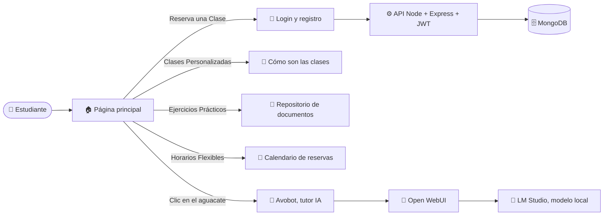

# 🥑 Avobot

Plataforma web de tutorías en **Matemáticas, Cálculo e Ingeniería Eléctrica** con un tutor de IA integrado en la página.



## ¿Qué hace cada parte?

| Botón o sección | Qué hace | Estado |
|---|---|---|
| **Reserva una Clase** | Lleva al login | Real: usa el backend |
| **Login y registro** | Crea usuarios y devuelve un token JWT | Real: guarda en MongoDB |
| **Clases Personalizadas** | Resumen de las clases con vistas ilustrativas | Demo: son maquetas, no capturas |
| **Ejercicios Prácticos** | Repositorio con filtros, buscador y vista previa | Demo: 9 documentos de ejemplo |
| **Horarios Flexibles** | Calendario para elegir día, hora y materia | Demo: las reservas se guardan solo en el navegador |
| **Avobot (aguacate)** | Chat con IA en un panel dentro de la página | Real: modelo local, lento en equipos modestos |

## Cómo está armado

```
Avobot_PoC/
├── backend/     API REST (Node, Express, Mongoose, JWT)
├── frontend/    Interfaz (React, Vite, Tailwind)
└── openwebui/   Open WebUI con la marca Avobot (docker-compose y logos)
```

| Pieza | Puerto | Para qué |
|---|---|---|
| Frontend (Vite) | 5173 | La página |
| Backend (Express) | 5000 | API de usuarios |
| MongoDB | 27017 | Base de datos `Avobot_POC`, colección `Avobot` |
| Open WebUI | 3000 | Interfaz del chat |
| LM Studio | 1234 | Servidor del modelo de IA |

## Puesta en marcha

### 1. Backend
```bash
cd backend
npm install
cp .env.example .env     # y rellena los valores
node server.js
```

Variables de `backend/.env`:
```
PORT=5000
MONGO_URI=mongodb://localhost:27017/Avobot_POC
JWT_SECRET=<una cadena larga y aleatoria>
```
> Nunca subas `.env` a git. Ya está en el `.gitignore`.

### 2. Frontend
```bash
cd frontend
npm install
npm run dev
```

### 3. Tutor IA (Avobot)
1. En LM Studio, descarga un modelo pequeño (por ejemplo **Qwen2.5-1.5B-Instruct**) y arranca el servidor local en el puerto 1234.
2. Levanta Open WebUI con la marca Avobot:
   ```bash
   cd openwebui
   docker compose up -d
   ```
3. En Open WebUI, ve a **Ajustes → Conexiones**, añade una conexión OpenAI con la URL `http://host.docker.internal:1234/v1` y guarda.
4. En **Ajustes → Modelos**, edita tu modelo y apaga **Herramientas Integradas**. Sin esto, cada pregunta lleva miles de tokens de más y el modelo tarda minutos.

La URL del chat se puede cambiar con `VITE_OPENWEBUI_URL` en `frontend/.env`.

## Limitaciones conocidas
- El nombre del chat aparece como "Avobot (Open WebUI)": Open WebUI añade ese sufijo sin licencia empresarial.
- Las reservas, los documentos y las vistas de clases son datos de ejemplo, sin backend.
- Los modelos locales de 7B o más son muy lentos en equipos con poca RAM.
